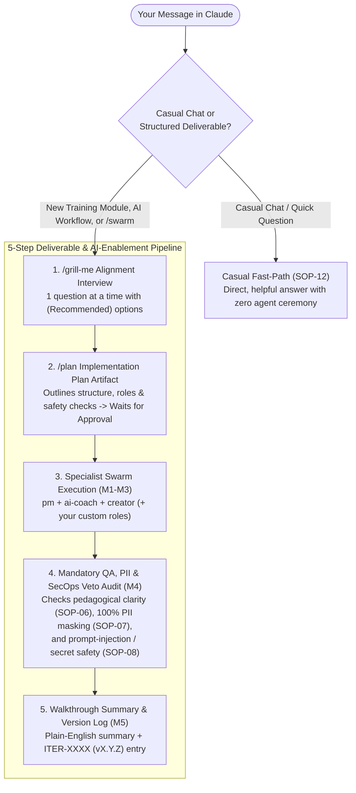

# Training & AI Enablement Swarm — Claude Lite Project Kit

> **Turn any Claude Project (Web or Desktop App) into a personal AI Training & Workflow Enablement Swarm in 2 minutes—with zero coding required.**

This kit gives a **Training & AI Enablement Lead** a structured, self-customizing multi-agent workspace inside Claude. It comes pre-wired with **enterprise safety & quality guardrails** (Universal PII Masking, Prompt-Injection & SecOps Veto checks, pre-task `/grill-me` + `/plan` alignment, and versioned iteration logging) while keeping **roles, workflows, and daily deliverables 100% customizable**.

---

## Repository Contents

| File | Where It Goes in Claude | Purpose |
| :--- | :--- | :--- |
| [**`00-QUICK-START-GUIDE.md`**](./00-QUICK-START-GUIDE.md) | **Read First** | Step-by-step 2-minute setup instructions and slash-command cheat sheet. |
| [**`01-PASTE-INTO-PROJECT-INSTRUCTIONS.md`**](./01-PASTE-INTO-PROJECT-INSTRUCTIONS.md) | Paste into **Project Instructions** | Master Router enforcing the Casual Chat Fast-Path (`SOP-12`), interactive `/setup` builder, `/grill-me` -> `/plan` gate, and QA/PII/SecOps reviews. |
| [**`02-MY-SWARM-ROSTER-AND-COMMANDS.md`**](./02-MY-SWARM-ROSTER-AND-COMMANDS.md) | Upload to **Project Knowledge** | Open intake worksheet, specialist roles (`pm`, `ai-coach`, `creator`, custom slots, and locked-in `qa-secops`), and custom `/` command templates. |
| [**`03-CORE-GUARDRAILS-PII-AND-SECOPS.md`**](./03-CORE-GUARDRAILS-PII-AND-SECOPS.md) | Upload to **Project Knowledge** | Always-on Universal PII Masking (`SOP-07`), Zero Secrets & Prompt-Injection Veto (`SOP-08`), Pedagogical QA (`SOP-06`), and `/walkthrough` (`SOP-11`). |
| [**`04-ITERATION-LOG-TEMPLATE.md`**](./04-ITERATION-LOG-TEMPLATE.md) | Upload to **Project Knowledge** | Numbered internal versioning ledger (`ITER-XXXX` / `vMAJOR.MINOR.PATCH`, `SOP-10`) to track every deliverable and update. |

---

## 2-Minute Setup in Claude (Web or Desktop)

1. **Create a Project:** Open Claude -> **Projects** -> **New Project** (e.g., `Training & AI Enablement Hub`).
2. **Set Project Instructions:** Copy the contents of [`01-PASTE-INTO-PROJECT-INSTRUCTIONS.md`](./01-PASTE-INTO-PROJECT-INSTRUCTIONS.md) and paste them into the **Set project instructions** box.
3. **Upload Project Knowledge:** Upload these 3 files into the **Project Knowledge** panel:
   - [`02-MY-SWARM-ROSTER-AND-COMMANDS.md`](./02-MY-SWARM-ROSTER-AND-COMMANDS.md)
   - [`03-CORE-GUARDRAILS-PII-AND-SECOPS.md`](./03-CORE-GUARDRAILS-PII-AND-SECOPS.md)
   - [`04-ITERATION-LOG-TEMPLATE.md`](./04-ITERATION-LOG-TEMPLATE.md)
4. **Customize Your Swarm (`/setup`):** Start a new chat in the Project and type `/setup`. Claude will interview you **one question at a time** (with `(Recommended)` options) about your training materials, team AI-enablement workflows, and leadership tasks, then generate a tailored `02-MY-SWARM-ROSTER-AND-COMMANDS.md` Artifact for you to save into Project Knowledge.

---

## How the Workflow Operates (`SOP-12`)

---

## Built-In Slash Commands Cheat Sheet

| Command | When to Use It | What Happens |
| :--- | :--- | :--- |
| *(Normal chat)* | Quick questions, brainstorming, or quick edits | **Casual Fast-Path:** Claude answers directly without activating multi-agent ceremony. |
| **`/setup`** | First-time onboarding (or when your role evolves) | Interviews you 1-by-1 and generates your customized `02-MY-SWARM-ROSTER-AND-COMMANDS.md`. |
| **`/grill-me <idea>`** | Turning a rough idea into a concrete spec | Interviews you 1 question at a time with `(Recommended)` choices until 100% aligned. |
| **`/plan <task>`** | Before drafting a major curriculum or rollout plan | Produces a structured **Plan Artifact** and waits for your approval before drafting. |
| **`/swarm <request>`** | End-to-end deliverable creation | Runs `/grill-me` -> `/plan` -> Specialist Roles -> `qa-secops` Audit -> `ITER-XXXX` Log. |
| **`/training-module <topic>`** | Building a new training session or lab | Produces learning objectives, facilitator guide/slides, hands-on lab (with synthetic data), and 1-page cheat sheet. |
| **`/ai-enable <team & workflow>`** | Helping a team adopt AI safely in their workflow | Produces As-Is vs. To-Be workflow map, safe prompt templates (with `<untrusted_input>` guards), human-in-the-loop checklist, and 30-60-90 day rollout plan. |
| **`/qa-secops <draft>`** | Auditing a deck, SOP, or prompt template | Runs the Quality (`SOP-06`), PII-Masking (`SOP-07`), and Prompt-Safety Veto (`SOP-08`) reviewer. |
| **`/walkthrough [topic]`** | Anything feels unclear or like a "blackbox" | Activates the **Training Program Manager (`pm`)** + **AI Workflow Architect (`ai-coach`)** to explain the *What/Why* and *How* with visual diagrams. |
| **`/log`** | Wrapping up a milestone or edit | Generates the next sequential `ITER-XXXX` (`vX.Y.Z`) block for `04-ITERATION-LOG-TEMPLATE.md`. |

---

## Locked-In Enterprise Guardrails (`SOP-06`–`SOP-12`)

- **Universal PII Masking (`SOP-07`):** All names, emails (`j***@d***.com`), phone numbers (`***-***-1234`), employee/customer IDs, and credentials (`[REDACTED_SECRET]`) are masked or synthetic across every training example, lab, and prompt playbook. Every team AI workflow includes a mandatory **Step 0: PII Scrubbing Check**.
- **SecOps & Prompt-Injection Veto (`SOP-08`):** Blocks hardcoded secrets or personal file paths, wraps untrusted external inputs inside `<untrusted_input>...</untrusted_input>` delimiters, and requires a **Human-in-the-Loop Verification Gate** before any AI output triggers external actions.
- **Pedagogical Quality Gate (`SOP-06`):** Enforces zero `[TODO]` placeholder gaps, clear learning objectives, step-by-step reproducibility, common pitfalls, and self-check rubrics.
- **Zero-Blackbox Transparency (`SOP-10` & `SOP-11`):** Every deliverable is versioned (`ITER-XXXX` / `vMAJOR.MINOR.PATCH`) and can be explained end-to-end anytime via `/walkthrough`.
